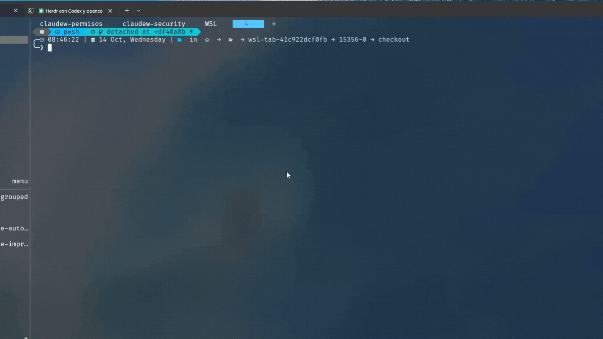

# herdr-wsl-tab

A [Herdr](https://herdr.dev) plugin for Windows that opens a tab (or split) whose process is
`wsl.exe`, so the pane *is* an Ubuntu (or any WSL distro) shell from its first prompt. It also
passes the `HERDR_*` variables through to Linux, so a coding agent or orchestrator started inside
that tab can drive Herdr with the Windows `herdr.exe`.

Herdr has one global `[terminal] default_shell`; there is no per-tab profile like Windows
Terminal's "Ubuntu" entry ([#4180](https://github.com/herdrdev/herdr/discussions/4180)). This
plugin is that missing entry.



## What you get

| Entry | Kind | What it does |
|---|---|---|
| `wsl-tab.open` | action | New tab running WSL, starting in the focused pane's directory |
| `wsl-tab.open-split` | action | Same, as a split next to the focused pane |
| `wsl-tab.setup` | action | Installs the `herdr` wrapper and the Claude Code hooks inside the distro, and lists the `HERDR_*` names in your user `WSLENV` (see below) |
| `wsl-tab.restore` | action | Relaunches WSL in panes that Herdr restored as plain shells (also runs automatically at startup) |
| `wsl-tab.doctor` | action | Prints distros, config, `WSLENV`, and whether `herdr` answers from inside WSL |
| `shell` | pane entrypoint | The WSL pane itself (`herdr plugin pane open --plugin wsl-tab --entrypoint shell`) |

If the focused pane already lives in WSL (cwd `\\wsl.localhost\<distro>\...`), the new tab starts
at that Linux path, opened in the configured (or default) distro; the source distro is not
selected automatically. Drive paths (`C:\...`) are handed to `wsl.exe --cd`, which maps them to
WSL's drive mounts (`/mnt/c/...`). Other network shares need a suitable mount on the Linux side.

## Install

```sh
herdr plugin install AndresDiagoM/herdr-wsl-tab
```

Requirements: Windows 10/11 with WSL 2 and at least one distro (`wsl -l -v`), Herdr 0.9.0 or
newer. Nothing to build; the plugin is three PowerShell scripts run with the Windows PowerShell
that ships with Windows.

Bind a key in `%APPDATA%\herdr\config.toml`:

```toml
[[keys.command]]
key = "prefix+shift+u"
type = "plugin_action"
command = "wsl-tab.open"
description = "open WSL tab"

[[keys.command]]
key = "prefix+shift+y"
type = "plugin_action"
command = "wsl-tab.open-split"
description = "open WSL split"
```

Or run it from the CLI: `herdr plugin action invoke wsl-tab.open`.

## Configure

Optional `config.json` in the plugin config directory (`herdr plugin config-dir wsl-tab`):

```json
{
  "distro": "Ubuntu",
  "cwd": "context",
  "wslenv": ["MY_EXTRA_VAR"],
  "args": []
}
```

| Key | Default | Meaning |
|---|---|---|
| `distro` | `""` (WSL default distro) | Passed as `wsl.exe -d <distro>` |
| `cwd` | `"context"` | `"context"` = focused pane's directory; `"~"` or `""` = Linux home; any other string (Linux or Windows path) is passed to `--cd` as is |
| `wslenv` | `[]` | Extra variable names to add to `WSLENV` for this pane (the `HERDR_*` set is always included) |
| `args` | `[]` | Extra arguments appended to `wsl.exe` (for example `["--", "fish"]`) |
| `restore` | `"all"` | After a Herdr restart: `"all"` relaunches WSL in the plugin's panes and in any pane saved inside `\\wsl.localhost\...`; `"plugin"` only the plugin's; `"off"` never |

See `config.example.json`.

## Driving Herdr from inside the WSL tab

The pane process receives `HERDR_ENV`, `HERDR_SOCKET_PATH`, `HERDR_BIN_PATH`, `HERDR_WORKSPACE_ID`,
`HERDR_TAB_ID` and `HERDR_PANE_ID` because the launcher adds them to `WSLENV` for that process
only; your global `WSLENV` is untouched. The values are Windows paths on purpose: `herdr.exe` is
the one that reads them.

Inside the distro there is no `herdr` on `PATH` (the server you want is the Windows one, not a
Linux install), so save this wrapper as `~/.local/bin/herdr`; it runs `herdr.exe` through WSL
interop:

```sh
#!/usr/bin/env bash
exe=""
if [ -n "${HERDR_BIN_PATH:-}" ]; then
  exe=$(wslpath -u "$HERDR_BIN_PATH" 2>/dev/null)
fi
if [ -z "$exe" ] || [ ! -x "$exe" ]; then
  exe=$(ls -d /mnt/c/Users/*/.herdr/packages/standalone/releases/*/herdr.exe 2>/dev/null | sort -V | tail -1)
fi
[ -x "$exe" ] || { echo "herdr: herdr.exe not found" >&2; exit 127; }
exec "$exe" "$@"
```

Then make it executable and reachable:

```sh
chmod +x ~/.local/bin/herdr
export PATH="$HOME/.local/bin:$PATH"   # Ubuntu's default ~/.profile already does this when the dir exists
```

(The same script is in `wsl/herdr` in this repo.) Then `herdr status` inside the tab reports the Windows server, and a Claude Code / Codex /
opencode session started there sees `HERDR_PANE_ID` and can use Herdr's agent skill. `wsl-tab.doctor`
checks all of this and prints what is missing.

## After a Herdr restart

Herdr restores a session as layout + each pane's saved directory, and every pane comes back
as the default shell. So without help a WSL tab comes back as `pwsh`.

The plugin handles that in two ways, both run by a `[[startup]]` hook after Herdr restores the
session (and on demand with `herdr plugin action invoke wsl-tab.restore`):

- panes this plugin opened are recorded (`panes.json` in the plugin state dir) and get WSL
  relaunched in the same distro and directory;
- with `"restore": "all"` (the default), any other pane whose saved directory is
  `\\wsl.localhost\<distro>\...`, i.e. one where you had typed `wsl` by hand, is relaunched too.

A pane is only touched when it is an idle shell: no agent, nothing else running. Set
`"restore": "plugin"` to limit it to the plugin's own panes, or `"off"`.

Claude Code sessions inside a WSL tab (with the hooks below) are resumed by Herdr itself: the hook
registers a resume command that re-enters the distro and runs `claude --resume <session>`.

## Making Herdr see Claude Code running inside the WSL tab

Herdr identifies agents by the pane's foreground process, and from Windows it only sees the
launcher, never the Linux `claude` process (herdr discussion #3347). So a Claude Code session
started in the WSL tab is a plain terminal to Herdr: no `claude` label, no `idle`/`working`
state in the sidebar.

A set of Claude Code hooks fixes the label and the state. They call `herdr pane report-agent`
from inside WSL through the wrapper above. One command installs the wrapper, the hook script and
the `settings.json` entries in the configured distro (idempotent; it backs up `settings.json`):

```sh
herdr plugin action invoke wsl-tab.setup
```

Or by hand, inside the distro: `bash wsl/setup.sh` from the plugin root, or copy
`wsl/claude-herdr-agent-state.sh` to `~/.claude/hooks/herdr-agent-state.sh` and merge
`wsl/claude-settings-hooks.json` into `~/.claude/settings.json`.

Verified on Herdr 0.9.4 / Claude Code in Ubuntu: with the hooks the pane shows `agent: claude`
and goes `idle` → `done` through a prompt, and `herdr agent explain` applies Herdr's own Claude
screen manifest to it. Without the hooks the same pane stays `agent: None`, `unknown`.

What the hooks do **not** give you: `herdr agent prompt` / `agent wait` on that pane. Herdr
rejects it ("agent … is no longer the pane foreground process"), see discussion #2935. Use
`herdr pane send-text` / `pane read` from the outside, or, better, let the Claude inside the tab be
the orchestrator: it can create tabs and drive Codex / opencode panes on Windows through the
wrapper, which is the setup this plugin was built for.

## How it works

`[[panes]] shell` runs `powershell.exe -File scripts/shell.ps1`, which reads `config.json`, picks
the start directory (`WSL_TAB_CD` from the action, else the plugin context, else `~`), converts a
`\\wsl.localhost\<distro>\path` into `/path`, extends `WSLENV`, and runs
`wsl.exe [-d distro] --cd <dir> [args]`. The actions call `herdr plugin pane open` with the right
placement and hand the focused pane's directory over with `--env WSL_TAB_CD=...`.

Tested on Windows 11, Herdr 0.9.4, WSL 2 with Ubuntu, Windows PowerShell 5.1.

## License

MIT
